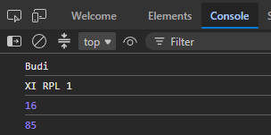
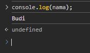
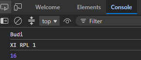
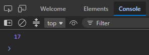
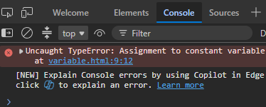
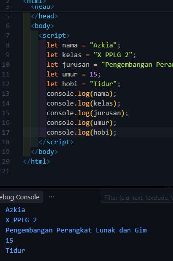
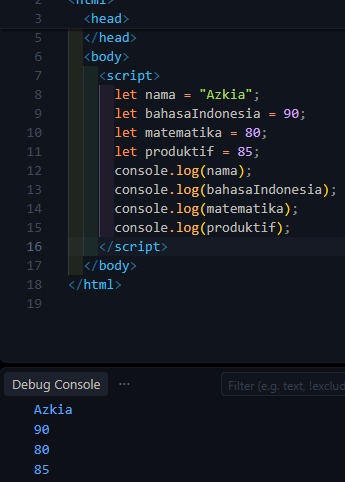
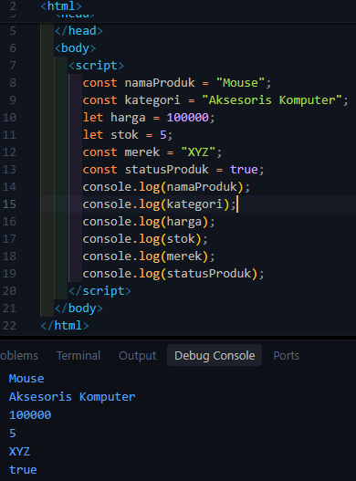

# Lembar Kerja JavaScript — Variable

> **Catatan:** Gambar/screenshot disimpan di folder `images/` agar dapat tampil di GitHub. Jangan memindahkan atau menghapus folder tersebut jika ingin gambar tetap muncul.

**Nama:** Azkia Nurul Qolbi  
**Kelas:** X PPLG 2  
**Tanggal:** Minggu, 04 Oktober 2026

## D. APERSEPSI

### Dugaanku:

```javascript
let namaSiswa = "Budi";
let kelas = "XI RPL 1";
let umur = 16;
let nilai = 85;

console.log(namaSiswa);
console.log(kelas);
console.log(umur);
console.log(nilai);
```

**Screenshot**



## E. AKTIVITAS 1 – MENGAMATI

### Pertanyaan

#### 1. Apa yang ditampilkan pada Console?

**Jawab:** Yang ditampilkan:

- Budi
- 16
- 85

#### 2. Menurutmu, apa fungsi nama, umur, dan nilai?

**Jawab:** Fungsi nama untuk menyimpan teks Budi, fungsi umur untuk menyimpan angka 16, fungsi nilai untuk menyimpan angka 85. Jadi ketiganya merupakan variable untuk menyimpan data yang dipanggil

#### 3. Apa yang terjadi jika kode berikut dijalankan?

```javascript
console.log(nama);
```

**Jawaban:** maka akan muncul teks Budi



#### 4. Menurut dugaanmu, apa yang dimaksud dengan variable?

**Jawab:** Variable adalah tempat untuk menyimpan sebuah data agar data tersebut dapat digunakan kembali oleh program.

## G. AKTIVITAS 3 – PRAKTIK MEMBUAT VARIABLE

### Hasil Pengamatan

Tuliskan hasil yang muncul pada Console.

```text
Nama : Budi
Kelas : XI RPL 1
Umur : 16
```

**Screenshot**



## H. AKTIVITAS 4 – EKSPERIMEN

### Pertanyaan

#### 1. Apakah hasil pada Console berubah?

**Jawab:** Ya berubah

#### 2. Bagian kode mana yang kamu ubah?

**Jawab:** Bagian variable isi `let nama`, `let kelas`, `let umur`

#### 3. Mengapa program dapat menampilkan data yang baru?

**Jawab:** Karena `console.log` bertugas menampilkan isi variable, jadi saat isi variable diubah maka akan muncul data yang baru

## I. AKTIVITAS 5 – VARIABLE UNTUK MENYIMPAN BERBAGAI DATA

JavaScript dapat menyimpan berbagai jenis data.

Perhatikan:

```javascript
let nama = "Andi";
let umur = 17;
let tinggi = 170;
let aktif = true;
```

### Identifikasi data tersebut

| Variable | Nilai  | Jenis Data            |
| -------- | ------ | --------------------- |
| `nama`   | “Andi” | String (teks)         |
| `umur`   | `17`   | Number (angka)        |
| `tinggi` | `170`  | Number (angka)        |
| `aktif`  | `true` | Boolean (benar/salah) |

### Kesimpulan

Data yang ditulis menggunakan tanda kutip seperti:

```text
“Andi”
```

merupakan data:

**Jawab:** String (teks)

Sedangkan:

```text
17
```

merupakan data:

**Jawab:** Number (angka)

## J. AKTIVITAS 6 – MENGENAL `let` DAN `const`

Perhatikan kode berikut:

```javascript
let umur = 16;
umur = 17;
console.log(umur);
```

Jalankan program tersebut.

**Hasil:** `17`



Sekarang coba:

```javascript
const nama = "Budi";
nama = "Andi";
console.log(nama);
```

### Apa yang terjadi?

**Jawab:** error



### Kesimpulan Sementara

| Keyword | Nilai dapat diubah? | Kegunaan sederhana                             |
| ------- | ------------------- | ---------------------------------------------- |
| `let`   | Bisa diubah         | Untuk menyimpan data yang nilainya bisa diubah |
| `const` | Tidak bisa diubah   | Untuk menyimpan data yang tetap                |

## L. AKTIVITAS 8 – MANA YANG BENAR?

Berikan tanda ✓ pada nama variable yang benar dan tanda ✗ pada nama variable yang salah.

| No. | Nama Variable | ✓/✗ |
| --: | ------------- | :-: |
|   1 | `nama`        |  ✓  |
|   2 | `namaSiswa`   |  ✓  |
|   3 | `nama_siswa`  |  ✓  |
|   4 | `2nama`       |  ✗  |
|   5 | `nama siswa`  |  ✗  |
|   6 | `nilaiAkhir`  |  ✓  |
|   7 | `nilai1`      |  ✓  |
|   8 | `nilai-akhir` |  ✗  |
|   9 | `Alamat`      |  ✓  |
|  10 | `alamatSiswa` |  ✓  |

### Perbaiki nama variable yang salah

**`2nama`**

Menjadi:

```javascript
nama2;
```

**`nama siswa`**

Menjadi:

```javascript
namaSiswa;
```

**`nilai-akhir`**

Menjadi:

```javascript
nilai_akhir;
```

## M. AKTIVITAS 9 – TANTANGAN DATA DIRI

Buat program JavaScript yang menyimpan data diri menggunakan variable.

Data yang harus disimpan:

1. Nama
2. Kelas
3. Jurusan
4. Umur
5. Hobi

Gunakan minimal 5 variable

### Jawaban

```javascript
let nama = "Azkia";
let kelas = "X PPLG 2";
let jurusan = "Pengembangan Perangkat Lunak dan Gim";
let umur = 15;
let hobi = "Tidur";

console.log(nama);
console.log(kelas);
console.log(jurusan);
console.log(umur);
console.log(hobi);
```

**Screenshot:**



## N. AKTIVITAS 10 – TANTANGAN LEVEL 2

Sekarang buat program untuk menyimpan data seorang siswa.

Data:

- Nama siswa
- Nilai Bahasa Indonesia
- Nilai Matematika
- Nilai Produktif

Kemudian tampilkan semua data menggunakan `console.log();`

### Jawaban

```javascript
let nama = "Azkia";
let bahasaIndonesia = 90;
let matematika = 80;
let produktif = 85;

console.log(nama);
console.log(bahasaIndonesia);
console.log(matematika);
console.log(produktif);
```

**Screenshot:**



### Pertanyaan

#### 1. Berapa variable yang kamu buat?

**Jawab:** 4 variable

#### 2. Mana variable yang menyimpan teks?

**Jawab:** variable nama

#### 3. Mana variable yang menyimpan angka?

**Jawab:** variable bahasa Indonesia, matematika, produktif

## O. AKTIVITAS 11 – DEBUGGING

Program berikut memiliki beberapa kesalahan.

```javascript
let nama siswa = "Budi";
let umur = 16;
let 2kelas = "XI RPL";

console.log(nama siswa);
console.log(umur);
console.log(2kelas);
```

### Tugas

Temukan kesalahan tersebut dan perbaiki programnya.

### Program yang sudah diperbaiki:

```javascript
let namaSiswa = "Budi";
let umur = 16;
let kelas2 = "XI RPL";

console.log(namaSiswa);
console.log(umur);
console.log(kelas2);
```

### Apa saja kesalahan yang kamu temukan?

1. `let nama siswa` salah karena seharusnya tidak diberi spasi
2. `let 2kelas` salah karena seharusnya angka tidak boleh di depan
3. `console.log(nama siswa)` dan `console.log(2kelas)` juga salah karena memanggil variable yang tidak valid

## P. AKTIVITAS 12 – CHALLENGE

### Program "Profil Siswa"

Buat sebuah program JavaScript sederhana yang menyimpan:

- Nama
- Kelas
- Jurusan
- Umur
- Kota
- Hobi
- Cita-cita

Kemudian tampilkan seluruh data tersebut menggunakan `console.log()`.

### Contoh

```javascript
const nama = "Andi";
const kelas = "XI RPL 1";
const jurusan = "Rekayasa Perangkat Lunak";
const umur = 17;
const kota = "Garut";
const hobi = "Coding";
const citaCita = "Programmer";

console.log(nama);
console.log(kelas);
console.log(jurusan);
console.log(umur);
console.log(kota);
console.log(hobi);
console.log(citaCita);
```

### Kembangkan program tersebut!

```javascript
const nama = "Azkia";
const kelas = "X PPLG 2";
const jurusan = "Pengembangan Perangkat Lunak dan Gim";
const umur = 15;
const kota = "Garut";
const hobi = "Tidur";
const citaCita = "CEO";
const sekolah = "SMK Negeri 1 Garut";
const tinggi = 162;

console.log(nama);
console.log(kelas);
console.log(jurusan);
console.log(umur);
console.log(kota);
console.log(hobi);
console.log(citaCita);
console.log(sekolah);
console.log(tinggi);
```

### Tambahkan minimal 2 variable baru.

**Variable tambahan:**

1. `sekolah`
2. `tinggi`

## Q. AKTIVITAS 13 – THINK PAIR SHARE

### Think

Jawab sendiri terlebih dahulu.

**Menurutmu, mengapa programmer membutuhkan variable?**

**Jawab:** karena programmer membutuhkan variable untuk menyimpan data di dalam program supaya data tersebut bisa dipakai, dibaca, dan diubah kapan pun

### Pair

Bandingkan jawabanmu dengan teman.

**Apakah jawaban kalian sama?** Ya/Tidak

**Jika berbeda, apa perbedaannya?**

## R. REFLEKSI

Berikan tanda ✓ sesuai dengan pemahamanmu.

| Pertanyaan                                             | Belum Paham | Mulai Paham | Paham |
| ------------------------------------------------------ | :---------: | :---------: | :---: |
| Saya memahami pengertian variable                      |             |      ✓      |       |
| Saya dapat membuat variable dengan `let`               |             |      ✓      |       |
| Saya memahami penggunaan `const`                       |             |      ✓      |       |
| Saya dapat menyimpan data ke dalam variable            |             |      ✓      |       |
| Saya dapat menampilkan variable dengan `console.log()` |             |      ✓      |       |
| Saya dapat memberikan nama variable dengan benar       |             |      ✓      |       |
| Saya dapat menemukan kesalahan variable                |             |      ✓      |       |

## S. REFLEKSI 3-2-1

### 3 Hal yang Saya Pelajari

1. variable adalah tempat untuk menyimpan sebuah data agar data tersebut dapat digunakan kembali oleh program.
2. `let` digunakan untuk data yang masih mungkin berubah, sedangkan `const` digunakan untuk data yang tidak perlu diubah.
3. nama variable mempunyai aturan untuk tidak boleh diawali angka, tidak boleh menggunakan spasi, dan tidak boleh menggunakan tanda hubung (`-`)

### 2 Hal yang Masih Membingungkan

1. kapan sebaiknya memakai `let` dan `const`
2. misalnya kalau angka 17 menggunakan tipe data string apakah bisa

### 1 Hal yang Ingin Saya Coba

1. membuat program menentukan nilai rata-rata dari setiap mata pelajaran

## T. KESIMPULAN

Lengkapi kalimat berikut.

**Variable** adalah tempat untuk menyimpan sebuah data agar data tersebut dapat digunakan kembali oleh program.

**`let`** digunakan untuk data yang masih mungkin berubah

**`const`** digunakan untuk data yang tidak perlu diubah

Untuk menampilkan isi variable ke Console kita dapat menggunakan `console.log();`

## U. TUGAS INDIVIDU

Buat sebuah program JavaScript dengan tema:

> **"Data Produk Sederhana"**

Program harus memiliki minimal 6 variable:

1. Nama produk
2. Kategori
3. Harga
4. Stok
5. Merek
6. Status produk

### Ketentuan

- Minimal 6 variable.
- Gunakan `let` dan `const`.
- Gunakan nama variable yang benar.
- Minimal terdapat data teks dan angka.
- Program harus dapat dijalankan tanpa error.
- Siswa harus mampu menjelaskan fungsi setiap variable.

### Jawaban

```javascript
const namaProduk = "Mouse";
const kategori = "Aksesoris Komputer";
let harga = 100000;
let stok = 5;
const merek = "XYZ";
const statusProduk = true;

console.log(namaProduk);
console.log(kategori);
console.log(harga);
console.log(stok);
console.log(merek);
console.log(statusProduk);
```

**Screenshot:**



## X. EXIT TICKET

Sebelum meninggalkan kelas, jawab tiga pertanyaan berikut.

### 1. Apa itu variable?

**Jawab:** Variable adalah tempat untuk menyimpan sebuah data agar data tersebut dapat digunakan kembali oleh program.

### 2. Apa perbedaan `let` dan `const`?

**Jawab:** `let` digunakan untuk data yang masih mungkin berubah, sedangkan `const` digunakan untuk data yang tidak perlu diubah.

### 3. Tuliskan satu contoh variable JavaScript.

**Jawab:** `let nama = "Azkia";`
